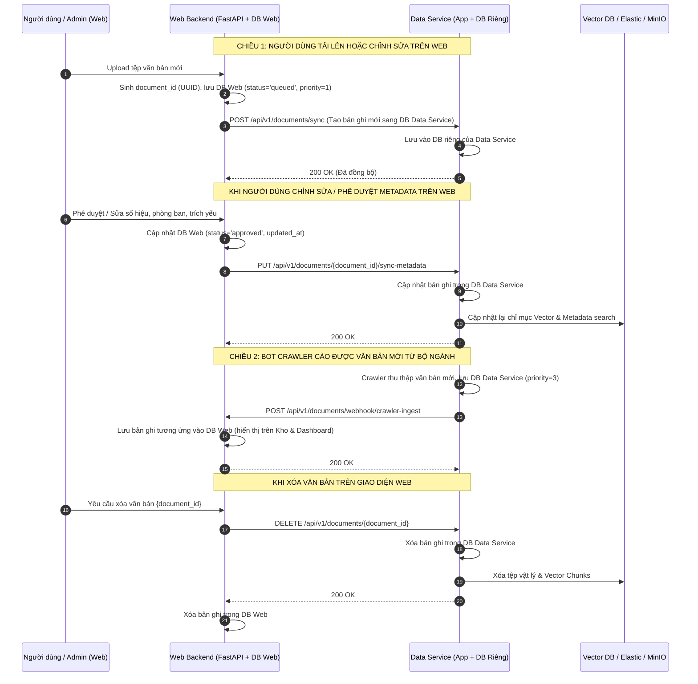

# TÀI LIỆU PHỐI HỢP KỸ THUẬT VÀ ĐẶC TẢ API - PHÂN HỆ DATA SERVICE

> **Kính gửi:** Đội ngũ Phát triển Dịch vụ Dữ liệu (Data Service Team)  
> **Dự án:** Hệ thống Tiếp nhận và Xử lý Văn bản Tự động - PTIT ADCS  
> **Từ phía:** Đội ngũ Phát triển Web Backend & Frontend (Main Website)  
> **Mục đích:** Thống nhất kiến trúc và cơ chế **Đồng bộ Dữ liệu 2 chiều giữa Cơ sở dữ liệu Web Backend và Cơ sở dữ liệu Data Service**, chuẩn hóa mã định danh, nâng cấp API Kho văn bản và giải quyết các task kỹ thuật: **[W3]**, **[W10]**, **[W11]**, **[W13]**.

---

## 1. TỔNG HỢP NỘI DUNG PHỐI HỢP TRỌNG TÂM

| Hạng mục | Nội dung kỹ thuật phối hợp với Data Service |
| :--- | :--- |
| **Đồng bộ 2 Cơ sở dữ liệu (Dual DB Sync)** | Thiết lập cơ chế **đồng bộ dữ liệu 2 chiều** giữa DB Web (`adcs_db_2` - PostgreSQL) và DB riêng của Data Service. Đảm bảo tính nhất quán (Eventual Consistency) khi có sự kiện: Tạo mới, Cập nhật Metadata, Phê duyệt AI, và Xóa. |
| **[W11] Chuẩn hóa ID & Xóa đồng bộ 2 nơi** | Bắt buộc dùng chung **`document_id` (chuẩn UUID v4)** làm khóa chính trên cả 2 DB và Vector DB. Khi xóa trên Web, Data Service xóa triệt để cả bản ghi DB, File vật lý và Vector Embeddings. |
| **[W10] Nâng cấp API Kho văn bản** | Cập nhật API `POST /api/v1/search/documents`: Hỗ trợ **`query` rỗng** (trả danh sách mặc định mới nhất), hỗ trợ **lọc độc lập theo ngày tháng, phòng ban, loại văn bản** mà không bắt buộc có từ khóa. |
| **[W3] Phân luồng hàng đợi (User vs Crawler)** | Thống nhất trường độ ưu tiên (`priority`). Văn bản do người dùng tải lên trực tiếp được ưu tiên xử lý trước (`priority=1`), văn bản từ bot crawler xếp sau (`priority=3`). |
| **[W13] Đồng bộ Cấu hình Tìm kiếm** | Data Service tiếp nhận các tham số tìm kiếm (ngưỡng tương đồng `similarity_threshold`, số lượng văn bản tối đa `top_k`) từ Web. |
| **Cơ chế Đối soát & Bù trừ dữ liệu (Reconciliation)** | Cung cấp API đối soát định kỳ và cơ chế Outbox/Retry để tự phục hồi khi có sự cố mạng giữa 2 service. |

---

## 2. KIẾN TRÚC ĐỒNG BỘ DỮ LIỆU GIỮA HAI CƠ SỞ DỮ LIỆU



---

## 3. CHI TIẾT CÁC THỰC THỂ DỮ LIỆU CẦN ĐỒNG BỘ

Cả 2 cơ sở dữ liệu cần đảm bảo khớp các trường thông tin then chốt sau:

| Tên trường (Field) | Kiểu dữ liệu | Ý nghĩa | Chiều ưu tiên nguồn dữ liệu gốc (Single Source of Truth) |
| :--- | :--- | :--- | :--- |
| `document_id` | UUID v4 (string) | **Khóa chính dùng chung** | Sinh ra bởi bên tiếp nhận đầu tiên (Web hoặc Crawler) |
| `so_hieu_van_ban` | varchar(255) | Số/Ký hiệu văn bản (VD: `125/QĐ-HV`) | Web cập nhật sau khi Admin/Người dùng duyệt |
| `so_den` | varchar(255) | Số đến theo sổ văn thư | Web cập nhật |
| `trich_yeu` | text | Tóm tắt trích yếu nội dung văn bản | Web cập nhật |
| `co_quan_ban_hanh` | text | Cơ quan/Đơn vị ban hành văn bản | AI trích xuất / Web duyệt |
| `ngay_ban_hanh` | date (YYYY-MM-DD) | Ngày ban hành văn bản | AI trích xuất / Web duyệt |
| `ngay_den` | timestamp | Ngày tiếp nhận văn bản vào hệ thống | Hệ thống ghi nhận |
| `ngay_het_han` | date (YYYY-MM-DD) | Hạn xử lý văn bản đề xuất | AI đề xuất / Web duyệt |
| `loai_van_ban` | varchar(100) | Quyết định, Công văn, Tờ trình, Báo cáo... | AI phân loại / Web duyệt |
| `do_khan` | varchar(50) | Hỏa tốc, Thượng khẩn, Khẩn, Thường | AI trích xuất / Web duyệt |
| `assigned_department_code` | varchar(50) | Mã phòng ban được phân luồng xử lý | Web duyệt |
| `assigned_user_id` | UUID (string) | Cán bộ phụ trách xử lý văn bản | Web gán |
| `status` | varchar(50) | `queued`, `processing`, `processed`, `approved`, `failed` | Cả 2 chiều đồng bộ |
| `summary` | text | Đoạn văn tóm tắt nội dung chính do AI sinh | AI Service / Web duyệt |
| `key_points` | jsonb (array) | Các điểm cốt lõi của văn bản | AI Service |
| `local_path` | text | Đường dẫn lưu trữ file vật lý trên server | Data Service quản lý |
| `file_hash` | varchar(64) | SHA-256 hash của tệp để chống trùng lặp | Cả 2 cùng kiểm tra |
| `source_type` | varchar(50) | `user_upload`, `crawler`, `email`, `translation` | Bên tạo quy định |
| `priority` | integer | Mức độ ưu tiên xử lý (1: Cao nhất, 3: Thấp nhất) | 1 cho user, 3 cho crawler |
| `updated_at` | timestamp | Dấu thời gian cập nhật gần nhất | Dùng để đối soát lệch dữ liệu |

---

## 4. ĐẶC TẢ HỢP ĐỒNG API ĐỒNG BỘ DỮ LIỆU (SYNC API CONTRACT)

### 4.1. [Chiều Web -> Data Service] Đồng bộ Tạo mới Văn bản
Khi người dùng tải văn bản lên Web, sau khi lưu file và tạo bản ghi ở DB Web, Web Backend sẽ thông báo sang DB Data Service:
* **Method:** `POST`
* **URL:** `http://<DATA_SERVICE_HOST>:<PORT>/api/v1/documents/sync`
* **Headers:** `Content-Type: application/json`, `X-Request-ID: <UUID>`

#### Request Payload:
```json
{
  "document_id": "9b1deb4d-3b7d-4bad-9bdd-2b0d7b3dcb6d",
  "filename": "125_QD_HV_2026.pdf",
  "file_path": "/mnt/data2tb/adcs/uploads/2026/10/125_QD_HV_2026.pdf",
  "file_size": 2048500,
  "source_type": "user_upload",
  "priority": 1,
  "status": "queued",
  "uploaded_by_user_id": "3a886b40-2045-4df6-880a-995a98cfda33",
  "created_at": "2026-10-17T08:30:00Z"
}
```

#### Response (HTTP 200 OK):
```json
{
  "status": "success",
  "document_id": "9b1deb4d-3b7d-4bad-9bdd-2b0d7b3dcb6d",
  "message": "Đã lưu bản ghi đồng bộ vào DB Data Service"
}
```

---

### 4.2. [Chiều Web -> Data Service] Đồng bộ Cập nhật Metadata & Phê duyệt AI
Khi người dùng/chuyên viên kiểm tra, chỉnh sửa thông tin trích xuất hoặc phê duyệt kết quả AI trên Web, Web Backend gọi API này để cập nhật DB Data Service và re-index Vector DB:
* **Method:** `PUT`
* **URL:** `http://<DATA_SERVICE_HOST>:<PORT>/api/v1/documents/{document_id}/sync-metadata`
* **Headers:** `Content-Type: application/json`, `X-Request-ID: <UUID>`

#### Request Payload:
```json
{
  "document_id": "9b1deb4d-3b7d-4bad-9bdd-2b0d7b3dcb6d",
  "so_hieu_van_ban": "125/QĐ-HV",
  "so_den": "SD-2026/0452",
  "trich_yeu": "Quyết định ban hành quy chế quản lý đề tài nghiên cứu khoa học sinh viên",
  "co_quan_ban_hanh": "Học viện Công nghệ Bưu chính Viễn thông",
  "ngay_ban_hanh": "2026-10-15",
  "ngay_den": "2026-10-16T08:00:00Z",
  "ngay_het_han": "2026-10-23",
  "loai_van_ban": "Quyết định",
  "do_khan": "Thường",
  "nguoi_ky": "Đặng Hoài Bắc",
  "chuc_vu_nguoi_ky": "Giám đốc",
  "assigned_department_code": "P_QLKH",
  "assigned_user_id": "e91244e8-8a8f-4ad2-88f6-17b203c945a1",
  "status": "approved",
  "summary": "Tóm tắt văn bản đã được chuyên viên kiểm duyệt...",
  "key_points": [
    "Kinh phí hỗ trợ tối đa 15 triệu đồng/đề tài.",
    "Bắt buộc có bài báo kỷ yếu."
  ],
  "updated_at": "2026-10-17T09:15:00Z"
}
```

#### Response (HTTP 200 OK):
```json
{
  "status": "success",
  "document_id": "9b1deb4d-3b7d-4bad-9bdd-2b0d7b3dcb6d",
  "message": "Đã cập nhật DB Data Service và lập lại chỉ mục Vector thành công",
  "reindexed": true
}
```

---

### 4.3. [Chiều Data Service -> Web] Webhook Báo Văn bản Thu thập từ Crawler
Khi bot crawler của Data Service thu thập được văn bản mới từ các cơ quan bên ngoài, Data Service gọi webhook sang Web Backend để ghi nhận vào DB Web:
* **Method:** `POST`
* **URL:** `http://<WEB_BACKEND_HOST>:8000/api/v1/documents/webhook/crawler-ingest`
* **Headers:** `Content-Type: application/json`, `X-Service-Key: <SECRET_KEY>`

#### Request Payload:
```json
{
  "document_id": "c56a8d11-5b7d-4444-9999-aaabbbcccddd",
  "source_name": "Cổng thông tin Bộ Thông tin và Truyền thông",
  "source_url": "https://mic.gov.vn/van-ban/123.html",
  "filename": "mic_van_ban_123.pdf",
  "file_path": "/mnt/data2tb/adcs/uploads/crawler/2026/mic_123.pdf",
  "file_size": 1542000,
  "so_hieu_van_ban": "45/2026/TT-BTTTT",
  "trich_yeu": "Thông tư quy định tiêu chuẩn kỹ thuật an toàn thông tin mạng",
  "co_quan_ban_hanh": "Bộ Thông tin và Truyền thông",
  "ngay_ban_hanh": "2026-10-10",
  "loai_van_ban": "Thông tư",
  "priority": 3,
  "status": "queued",
  "created_at": "2026-10-17T07:00:00Z"
}
```

#### Response (HTTP 200 OK):
```json
{
  "status": "success",
  "document_id": "c56a8d11-5b7d-4444-9999-aaabbbcccddd",
  "message": "Đã tiếp nhận văn bản crawler vào hàng đợi DB Web"
}
```

---

### 4.4. [W11] Xóa Văn bản Đồng bộ 2 Chiều
Khi văn bản bị xóa trên Web, Data Service phải xóa dọn dẹp toàn bộ dữ liệu ở DB riêng của mình, File lưu trữ và Vector DB:
* **Method:** `DELETE`
* **URL:** `http://<DATA_SERVICE_HOST>:<PORT>/api/v1/documents/{document_id}`
* **Path Parameter:** `document_id` (UUID v4)

#### Response (HTTP 200 OK):
```json
{
  "status": "success",
  "document_id": "9b1deb4d-3b7d-4bad-9bdd-2b0d7b3dcb6d",
  "deleted_from_db": true,
  "deleted_files": true,
  "deleted_vectors_count": 12,
  "message": "Đã xóa hoàn toàn văn bản khỏi hệ thống Data Service"
}
```

---

### 4.5. [W10] Nâng cấp API Tìm kiếm & Lọc Kho Văn bản
API tìm kiếm được nâng cấp để hỗ trợ **`query` rỗng** (mặc định lấy danh sách mới nhất) và các bộ lọc độc lập:
* **Method:** `POST`
* **URL:** `http://<DATA_SERVICE_HOST>:<PORT>/api/v1/search/documents`

#### Request Payload Mẫu:
```json
{
  "query": null,
  "from_date": "2026-10-01",
  "to_date": "2026-10-17",
  "department_code": "P_QLKH",
  "loai_van_ban": "Quyết định",
  "page": 1,
  "page_size": 20,
  "similarity_threshold": 0.65
}
```
*(Nếu `query` là `null` hoặc chuỗi rỗng `""`, Data Service không chạy Vector search mà trả về danh sách văn bản sắp xếp theo `ngay_ban_hanh DESC` hoặc `created_at DESC`)*

#### Response (HTTP 200 OK):
```json
{
  "status": "success",
  "total": 35,
  "page": 1,
  "page_size": 20,
  "total_pages": 2,
  "results": [
    {
      "document_id": "9b1deb4d-3b7d-4bad-9bdd-2b0d7b3dcb6d",
      "best_similarity": 1.0,
      "document": {
        "so_ky_hieu": "125/QĐ-HV",
        "trich_yeu": "Quyết định ban hành quy chế quản lý đề tài NCKH sinh viên",
        "loai_van_ban_text": "Quyết định",
        "don_vi_ban_hanh": "Học viện Công nghệ Bưu chính Viễn thông",
        "ngay_van_ban": "2026-10-15",
        "nguoi_ky": "Đặng Hoài Bắc",
        "chuc_vu_nguoi_ky": "Giám đốc",
        "summary": "Tóm tắt nội dung văn bản...",
        "key_points": ["Điểm 1", "Điểm 2"],
        "assigned_department_code": "P_QLKH",
        "assigned_department_name": "Phòng Quản lý Khoa học công nghệ và Hợp tác quốc tế",
        "local_path": "/mnt/data2tb/adcs/uploads/2026/10/125_QD_HV_2026.pdf",
        "created_at": "2026-10-15T09:30:00Z"
      }
    }
  ]
}
```

---

### 4.6. Cơ chế Đối soát Dữ liệu Lệch (Reconciliation API)
Để xử lý trường hợp một trong hai bên gặp sự cố mạng hoặc restart khiến việc gọi API đồng bộ thời gian thực bị gián đoạn, Data Service và Web cung cấp endpoint đối soát định kỳ (ví dụ chạy vào 02:00 sáng mỗi ngày):
* **Method:** `POST`
* **URL:** `http://<DATA_SERVICE_HOST>:<PORT>/api/v1/sync/reconcile`
* **Payload:** Gửi danh sách các `document_id` và `updated_at` trong 24 giờ qua:
  ```json
  {
    "check_date": "2026-10-17",
    "documents": [
      {
        "document_id": "9b1deb4d-3b7d-4bad-9bdd-2b0d7b3dcb6d",
        "updated_at": "2026-10-17T09:15:00Z",
        "status": "approved"
      }
    ]
  }
  ```
* **Response:** Trả về danh sách các `missing_in_data_service` và `outdated_in_data_service` để Web Backend tự động đẩy bù dữ liệu.

---

