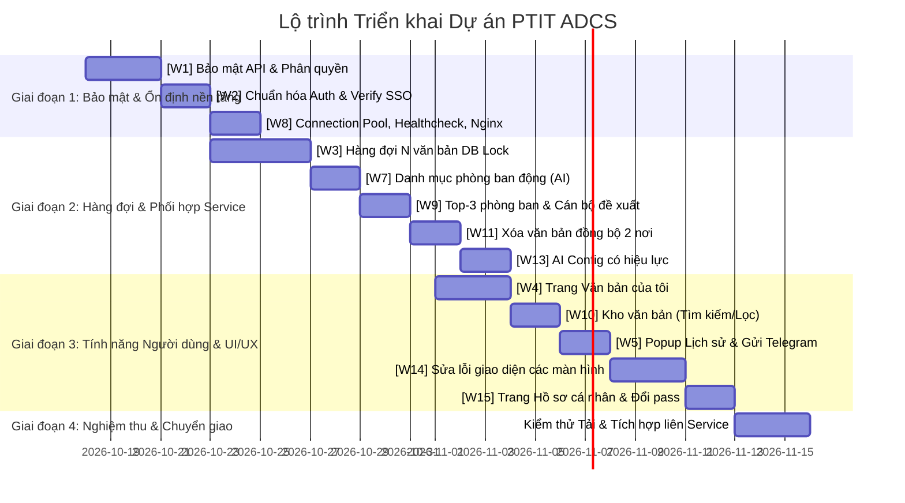

# KẾ HOẠCH CHI TIẾT SỬA ĐỔI MÃ NGUỒN FRONTEND VÀ BACKEND (PTIT ADCS)

> **Dự án:** Hệ thống Tiếp nhận và Xử lý Văn bản Tự động - PTIT ADCS  
> **Thời gian lập kế hoạch:** Tháng 10/2026  
> **Mục tiêu:** Nâng cấp toàn diện tính an toàn, bảo mật, khả năng mở rộng, độ ổn định và trải nghiệm người dùng của cả hai phân hệ **adcs-backend** (FastAPI) và **adcs-frontend** (React/Vite).

---

## MỤC LỤC TỔNG QUAN CÁC TASK

| Mã Task | Tên Task | Phân hệ ảnh hưởng | Service phối hợp | Trạng thái |
| :--- | :--- | :--- | :--- | :--- |
| **[W1]** | Bảo mật API và Phân quyền | Backend + Frontend | Không | ✅ Đã hoàn thành |
| **[W2]** | Đăng ký, Đăng nhập, PTIT SSO | Backend + Frontend | SSO Gateway (PTIT) | ✅ Đã hoàn thành |
| **[W3]** | Xử lý nền, tối đa N văn bản cùng lúc | Backend + Database | AI Server, Data Service | ✅ Đã hoàn thành |
| **[W4]** | Trang "Văn bản của tôi" | Backend + Frontend | Không | ✅ Đã hoàn thành |
| **[W5]** | Xem chi tiết lượt xử lý & Gửi Telegram | Backend + Frontend | Telegram Bot API | ✅ Đã hoàn thành |
| **[W7]** | Danh mục phòng ban cho AI | Backend + Frontend | **AI Server** | ✅ Đã hoàn thành |
| **[W8]** | Backend chịu tải, tự hồi phục | Backend + Infra (Docker, Nginx) | Không | ✅ Đã hoàn thành |
| **[W9]** | Hiển thị top-3 phòng ban gợi ý | Backend + Frontend | **AI Server** | ✅ Đã hoàn thành |
| **[W10]** | Kho văn bản (Tìm kiếm & Bộ lọc) | Backend + Frontend | **Data Service** | ✅ Đã hoàn thành |
| **[W11]** | Xóa văn bản đồng bộ 2 nơi | Backend + Frontend | **Data Service** | ✅ Đã hoàn thành |
| **[W13]** | Cấu hình AI Config có hiệu lực | Backend + Frontend | **AI Server**, **Data Service** | ✅ Đã hoàn thành |
| **[W14]** | Sửa lỗi giao diện các màn hình | Frontend | Không | ✅ Đã hoàn thành |
| **[W15]** | Hồ sơ cá nhân, Đổi mật khẩu, Quản lý Telegram | Backend + Frontend | Telegram Bot API | ✅ Đã hoàn thành |

---

## CHI TIẾT KẾ HOẠCH TRIỂN KHAI TỪNG TASK

---

### [W1] BẢO MẬT API VÀ PHÂN QUYỀN

#### 1. Hiện trạng & Nguyên nhân
* **Lỗ hổng xác thực:** Hàng loạt endpoint trọng yếu tại [document.py](file:///home/hieudt/ADCS/adcs-website/main-website/adcs-backend/app/api/v1/endpoints/document.py) (`/stats`, `""`, `/all`, `/{id}`, `/{id}/file`) không có dependency xác thực `get_current_user`, bất kỳ ai có URL đều truy cập được dữ liệu nội bộ.
* **Lộ Token nhạy cảm:** Endpoint `GET /api/telegram/bot-token` tại [telegram.py](file:///home/hieudt/ADCS/adcs-website/main-website/adcs-backend/app/api/v1/endpoints/telegram.py) trả thẳng API Token Telegram Bot cho bất kỳ client nào gọi tới. Endpoint `/notify_by_roles` mở công khai không kiểm tra xác thực.
* **Cơ chế phân quyền yếu:** Hiện tại chỉ có `RoleChecker(['admin'])` kiểm tra thô sơ theo tên vai trò, chưa kiểm tra theo mã quyền (`Permission.code`) có trong bảng `permissions`.
* **Rò rỉ dữ liệu chéo:** Người dùng xem được tất cả văn bản của cơ quan, không bị giới hạn theo cá nhân (`uploaded_by_user_id`) hoặc phòng ban (`assigned_department_id`).

#### 2. Kế hoạch sửa đổi Backend
* **File:** [adcs-backend/app/core/dependency.py](file:///home/hieudt/ADCS/adcs-website/main-website/adcs-backend/app/core/dependency.py)
  * Xây dựng dependency `PermissionChecker(permission_code: str)`: Truy vấn danh sách quyền từ `RolePermission` và `Permission` tương ứng với `user.role_id`. Nếu không chứa mã quyền chỉ định thì trả về `HTTP 403 Forbidden`.
  * Xây dựng hàm `get_data_scope(current_user: User)`: Xác định phạm vi truy cập:
    * `admin`/`super_admin`: Toàn quyền (`scope = 'ALL'`).
    * `department_manager`: Truy cập dữ liệu của phòng ban mình (`scope = 'DEPARTMENT'`, `department_id = current_user.department_id`).
    * `regular_user`: Chỉ truy cập dữ liệu do chính mình tạo (`scope = 'OWNER'`, `user_id = current_user.user_id`).
* **File:** [adcs-backend/app/api/v1/endpoints/telegram.py](file:///home/hieudt/ADCS/adcs-website/main-website/adcs-backend/app/api/v1/endpoints/telegram.py)
  * Xóa bỏ hoàn toàn endpoint công khai `GET /bot-token` (hoặc chuyển thành endpoint quản trị chỉ trả về `bot_name` và `channel_type`, tuyệt đối không trả token).
  * Di chuyển Telegram Bot Token ra biến môi trường `TELEGRAM_BOT_TOKEN` trong `.env` thay vì truy vấn trực tiếp từ bảng cơ sở dữ liệu khi không cần thiết.
  * Endpoint `POST /notify_by_roles`: Bổ sung kiểm tra Secret Service Key (`x-service-key`) dành cho nội bộ Data Service hoặc Bearer Token Admin.
* **File:** [adcs-backend/app/api/v1/endpoints/document.py](file:///home/hieudt/ADCS/adcs-website/main-website/adcs-backend/app/api/v1/endpoints/document.py)
  * Gắn `Depends(get_current_user)` vào tất cả các route: `/stats`, `""`, `/all`, `/{document_id}`, `/{document_id}/file`.
  * Truyền đối tượng `current_user` xuống tầng Service để lọc văn bản theo scope.
* **File:** [adcs-backend/app/crud/document.py](file:///home/hieudt/ADCS/adcs-website/main-website/adcs-backend/app/crud/document.py) & [document_service.py](file:///home/hieudt/ADCS/adcs-website/main-website/adcs-backend/app/services/document_service.py)
  * Cập nhật các hàm truy vấn `get_documents()`, `get_document_stats()` nhận tham số lọc:
    ```python
    if scope == 'OWNER':
        query = query.filter(Document.uploaded_by_user_id == current_user.user_id)
    elif scope == 'DEPARTMENT':
        query = query.filter(Document.assigned_department_id == current_user.department_id)
    ```

#### 3. Kế hoạch sửa đổi Frontend
* **File:** `adcs-frontend/src/hooks/usePermission.ts`
  * Tạo custom hook `usePermission(requiredPermission: string): boolean` để kiểm tra quyền dựa trên danh sách quyền được trả về khi login.
* **File:** `adcs-frontend/src/components/common/Authorized.tsx`
  * Tạo component bọc `<Authorized permission="DOC_DELETE"> ... </Authorized>` tự động ẩn các nút chức năng (Xóa, Phê duyệt, Cấu hình) nếu tài khoản không đủ quyền.
* **File:** [adcs-frontend/src/layouts/components/Sidebar.tsx](file:///home/hieudt/ADCS/adcs-website/main-website/adcs-frontend/src/layouts/components/Sidebar.tsx)
  * Cập nhật cấu trúc menu `NAV_ITEMS`: Thay cờ `isAdminOnly` cứng bằng trường `requiredPermission` hoặc `requiredRole` linh hoạt.

---

### [W2] ĐĂNG KÝ, ĐĂNG NHẬP, PTIT SSO

#### 1. Hiện trạng & Nguyên nhân
* **Lỗi đăng ký trùng email:** [auth_service.py](file:///home/hieudt/ADCS/adcs-website/main-website/adcs-backend/app/services/auth_service.py) hàm `register()` không kiểm tra tồn tại của email trước khi ghi DB, dẫn đến văng lỗi `SQLAlchemy UniqueViolation` gây HTTP 500.
* **Chưa có luồng duyệt tài khoản:** Tài khoản mới đăng ký tự động có `is_active = True`, sử dụng được ngay lập tức các tính năng mà chưa được phân quyền.
* **Lỗ hổng bảo mật SSO:** Hàm `ptit_sso_login()` giải mã token bằng `jwt.get_unverified_claims(id_token)` mà không kiểm tra chữ ký số (signature validation), tiềm ẩn nguy cơ bị giả mạo danh tính (token forgery).
* **Sai nhãn giao diện:** Nút SSO tại màn hình đăng nhập đang ghi "Tiếp tục với Outlook" kèm logo Microsoft dù thực tế chạy qua hệ thống SSO Keycloak của PTIT (`gwdu.ptit.edu.vn`).

#### 2. Kế hoạch sửa đổi Backend
* **File:** [adcs-backend/app/services/auth_service.py](file:///home/hieudt/ADCS/adcs-website/main-website/adcs-backend/app/services/auth_service.py)
  * Trong `register()`:
    1. Kiểm tra định dạng email (bắt buộc đuôi `@ptit.edu.vn`).
    2. Kiểm tra độ phức tạp mật khẩu (tối thiểu 8 ký tự, bao gồm chữ hoa, chữ thường, số).
    3. Truy vấn `get_user_by_email()`, nếu đã tồn tại thì `raise HTTPException(status_code=400, detail="Email này đã được đăng ký trong hệ thống!")`.
    4. Gán mặc định `is_active = False` và `role_id = None` (chờ phê duyệt).
  * Trong `login()`:
    * Kiểm tra: Nếu `not user.is_active` -> trả về lỗi HTTP 403: `"Tài khoản của bạn đang chờ Quản trị viên duyệt và phân quyền."`.
    * Nếu `not user.role_id` -> trả về lỗi HTTP 403: `"Tài khoản chưa được gán quyền sử dụng."`.
  * Nâng cấp `ptit_sso_login()`:
    * Tải bộ khóa công khai JWKS từ `https://gwdu.ptit.edu.vn/sso/realms/ptit/protocol/openid-connect/certs` (có caching in-memory).
    * Sử dụng thư viện `python-jose` hoặc `PyJWT` để giải mã và kiểm tra chữ ký token `id_token` với thuật toán `RS256`, kiểm tra `audience` và `issuer`.
    * Đối với tài khoản SSO đăng nhập lần đầu: Tự động tạo bản ghi trong bảng `users` với `is_active = False` và thông báo chờ Admin kích hoạt vai trò.

#### 3. Kế hoạch sửa đổi Frontend
* **File:** [adcs-frontend/src/features/auth/components/AuthForm.tsx](file:///home/hieudt/ADCS/adcs-website/main-website/adcs-frontend/src/features/auth/components/AuthForm.tsx)
  * Đổi nhãn nút từ `"Tiếp tục với Outlook"` thành `"Đăng nhập bằng SSO PTIT"`.
  * Thay icon Microsoft bằng logo PTIT hoặc icon Edu Keycloak nhận diện trường.
* **File:** [adcs-frontend/src/features/auth/pages/RegisterPage.tsx](file:///home/hieudt/ADCS/adcs-website/main-website/adcs-frontend/src/features/auth/pages/RegisterPage.tsx)
  * Hiển thị thông báo thành công sau khi gửi form: *"Đăng ký thành công! Tài khoản của bạn đang chờ Ban Quản trị phê duyệt và cấp quyền."*.
  * Xử lý hiển thị thông báo lỗi rõ ràng khi trùng email hoặc mật khẩu không đúng định dạng.

---

### [W3] XỬ LÝ NỀN, TỐI ĐA N VĂN BẢN CÙNG LÚC

#### 1. Hiện trạng & Nguyên nhân
* **Lỗi nghẽn hàng loạt khi gửi đồng thời:** Endpoint `/upload` hiện dùng `BackgroundTasks` chạy không giới hạn luồng song song trên cùng một tiến trình; truyền trực tiếp mảng bytes `file_content` từ bộ nhớ RAM sang AI Service. Khi gửi 4 file cùng lúc, cả 4 tiến trình gọi AI cùng một thời điểm gây tràn socket, quá tải AI Server và lỗi toàn bộ.
* **Mất dữ liệu khi restart:** Không lưu file vật lý xuống ổ đĩa ngay khi nhận file. Nếu khởi động lại backend, tiến trình RAM mất tích và văn bản bị kẹt trạng thái `pending` vĩnh viễn.
* **Timeout cố định không thực tế:** Cố định timeout 300s đối với mọi văn bản, dẫn đến văn bản dài bị ngắt kết nối oan hoặc văn bản ngắn bị treo chờ vô ích.
* **Thiếu kiểm soát hạn ngạch:** Người dùng có thể upload file dung lượng lớn vô hạn hoặc gửi số lượng văn bản ồ ạt.

#### 2. Kế hoạch sửa đổi Backend
* **Cơ chế Hàng đợi Cơ sở dữ liệu (PostgreSQL Job Queue - Không phụ thuộc Message Queue ngoài):**
  * Thêm các trường vào bảng `documents`:
    * `file_path`: Đường dẫn lưu file vật lý trên máy chủ (`/mnt/data2tb/adcs/uploads/...`).
    * `original_filename`: Tên gốc của tệp.
    * `file_size_bytes`: Kích thước file (bytes).
    * `page_count`: Số trang PDF/DOCX (tính toán nhanh lúc upload).
    * `priority`: Độ ưu tiên (1: Người dùng tải lên, 2: Dịch thuật, 3: Crawler).
    * `retry_count`: Số lần thử lại (mặc định 0, tối đa 3).
    * `status`: Chuyển sang enum chuẩn: `'queued'`, `'processing'`, `'processed'`, `'failed'`.
    * `error_message`: Chi tiết nguyên nhân lỗi.
* **Cập nhật Endpoint Upload:**
  * Kiểm tra dung lượng file (tối đa ví dụ 50MB), kiểm tra số trang (tối đa 200 trang).
  * Kiểm tra số văn bản đang chờ của user (ví dụ: mỗi người tối đa 5 văn bản đang ở trạng thái `queued`/`processing`).
  * Lưu file ngay xuống ổ đĩa, ghi bản ghi `Document` với trạng thái `'queued'` và `priority = 1`.
  * Trả về kết quả cho client ngay lập tức (`document_id`, trạng thái `'queued'`) trong < 200ms.
* **Tiến trình Xử lý Nền (Background Worker Engine):**
  * Xây dựng worker định kỳ sử dụng cơ chế khóa phân tán trong PostgreSQL:
    ```sql
    SELECT document_id FROM documents
    WHERE status = 'queued' AND retry_count < 3
    ORDER BY priority ASC, created_at ASC
    LIMIT 1
    FOR UPDATE SKIP LOCKED;
    ```
  * Cấu hình số luồng chạy đồng thời qua biến môi trường `MAX_CONCURRENT_DOCUMENTS` (mặc định: 1).
  * Sử dụng Semaphore (`asyncio.Semaphore(MAX_CONCURRENT_DOCUMENTS)`) để kiểm soát số văn bản xử lý đồng thời. Ngay khi 1 văn bản hoàn tất, giải phóng semaphore để nhận ngay văn bản tiếp theo từ hàng đợi mà không cần chờ theo lô (batch).
  * **Tính Timeout động theo số trang:**
    * Bỏ mốc 300s.
    * Công thức tính: `timeout = max(60, min(1800, 30 + page_count * 15))` (ví dụ: 10 trang = 180s, 50 trang = 780s).
  * **Tự động khôi phục khi Restart:**
    * Trong sự kiện `@app.on_event("startup")`:
      ```python
      db.query(Document).filter(Document.status == 'processing').update({
          Document.status: 'queued',
          Document.retry_count: Document.retry_count + 1,
          Document.error_message: 'Hệ thống khởi động lại trong khi đang xử lý'
      })
      db.commit()
      ```
  * **Tích hợp Dịch thuật:**
    * Bảng `translations` cũng đưa vào cùng cơ chế xếp hàng này hoặc chuẩn hóa về cùng một queue xử lý AI.

#### 3. Phối hợp Service khác
* **AI Server:** Cung cấp thông tin ước tính số trang hoặc tiếp nhận tham số số trang từ Web Backend để tối ưu tài nguyên tính toán.

---

### [W4] TRANG "VĂN BẢN CỦA TÔI" (✅ ĐÃ HOÀN THÀNH)

#### 1. Hiện trạng & Nguyên nhân
* Hiện tại trang [DocumentPage.tsx](file:///home/hieudt/ADCS/adcs-website/main-website/adcs-frontend/src/features/documents/pages/DocumentPage.tsx) chỉ lưu một mã `lastActiveDocumentId` trong `sessionStorage`. Người dùng đóng tab hoặc chuyển sang màn hình khác là mất toàn bộ ngữ cảnh theo dõi. Không có giao diện danh sách văn bản cá nhân đã gửi lên.
* Nút "Xem tất cả" tại Dashboard hiện chưa được nối sự kiện click.

#### 2. Kế hoạch sửa đổi Backend
* **File:** [adcs-backend/app/api/v1/endpoints/document.py](file:///home/hieudt/ADCS/adcs-website/main-website/adcs-backend/app/api/v1/endpoints/document.py)
  * Thêm endpoint `GET /api/documents/my`:
    * Nhận các query params: `page`, `page_size`, `status`, `search`.
    * Chỉ trả về các văn bản do chính user gửi lên (`uploaded_by_user_id == current_user.user_id`).
    * Tính toán trường `queue_position`: Vị trí của văn bản trong hàng đợi chờ (nếu `status == 'queued'`).
    * Trả về chi tiết các bước xử lý: `queued` (Chờ xử lý), `processing` (Đang phân tích AI), `processed` (Hoàn tất), `failed` (Lỗi).
  * Thêm endpoint `POST /api/documents/{document_id}/retry`:
    * Cho phép thử lại nếu trạng thái là `'failed'`. Đặt lại `status = 'queued'`, `retry_count = 0`.
  * Thêm endpoint `POST /api/documents/{document_id}/cancel`:
    * Cho phép hủy nếu văn bản vẫn đang ở trạng thái `'queued'` (xóa khỏi hàng đợi).

#### 3. Kế hoạch sửa đổi Frontend
* **Tạo Trang Mới:** `adcs-frontend/src/features/documents/pages/MyDocumentsPage.tsx`
  * Hỗ trợ chọn **nhiều file** cùng lúc khi upload (Multi-file Drag & Drop).
  * Sau khi bấm "Gửi phân tích", người dùng có thể thoải mái rời trang, chuyển tab mà tiến trình ngầm vẫn chạy bình thường.
  * Bảng danh sách văn bản của tôi gồm:
    * Tên tệp, ngày gửi, kích thước, số trang.
    * Trạng thái và vị trí chờ (VD: *Đang chờ xử lý - Vị trí số 2 trong hàng đợi*).
    * Bước đang xử lý với hiệu ứng progress/skeleton.
    * Kết quả trích xuất nhanh (Số hiệu, Cơ quan ban hành, Trích yếu tóm tắt).
    * Nguyên nhân lỗi rõ ràng nếu thất bại.
  * Bộ nút thao tác:
    * **Xem:** Mở màn hình xem chi tiết kết quả phân tích.
    * **Xử lý lại (Retry):** Dành cho tài liệu bị lỗi.
    * **Hủy (Cancel):** Dành cho tài liệu đang chờ trong hàng đợi.
    * **Xóa:** Xóa văn bản (đồng bộ sang Data Service).
* **Nối điều hướng:**
  * Nút "Xem tất cả" trên [DashboardPage.tsx](file:///home/hieudt/ADCS/adcs-website/main-website/adcs-frontend/src/features/DashboardPage.tsx) chuyển hướng sang `/documents/my`.
  * Thêm mục "Văn bản của tôi" vào menu thanh bên [Sidebar.tsx](file:///home/hieudt/ADCS/adcs-website/main-website/adcs-frontend/src/layouts/components/Sidebar.tsx).

---

### [W5] XEM CHI TIẾT LƯỢT XỬ LÝ & GỬI TELEGRAM (✅ ĐÃ HOÀN THÀNH)

#### 1. Hiện trạng & Nguyên nhân
* Trang [HistoryPage.tsx](file:///home/hieudt/ADCS/adcs-website/main-website/adcs-frontend/src/features/history/HistoryPage.tsx) chỉ hiển thị bảng danh sách các lượt xử lý đơn thuần, không thể click để xem chi tiết kết quả của lượt xử lý đó.
* Chưa có chức năng gửi kết quả xử lý qua Telegram thủ công từ màn hình lịch sử khi cần chia sẻ lại.

#### 2. Kế hoạch sửa đổi Backend
* **File:** [adcs-backend/app/api/v1/endpoints/history.py](file:///home/hieudt/ADCS/adcs-website/main-website/adcs-backend/app/api/v1/endpoints/history.py)
  * Thêm endpoint `GET /api/history/{history_id}/detail`:
    * Trả về toàn bộ payload chi tiết của lượt xử lý: thông tin tệp, kết quả phân tích AI trích xuất được (các trường văn bản, tóm tắt, phòng ban gợi ý, độ tin cậy, thời gian xử lý các bước).
  * Thêm endpoint `POST /api/history/{history_id}/send-telegram`:
    * Kiểm tra: Chỉ cho phép gửi nếu trạng thái của lượt xử lý là hoàn tất (`status == 'success'` hoặc `status == 'processed'`).
    * Soạn mẫu tin nhắn thông báo HTML chuẩn chỉnh và gọi hàm `send_telegram_notification` gửi tới Telegram Chat ID của người dùng hoặc nhóm theo cấu hình.

#### 3. Kế hoạch sửa đổi Frontend
* **File:** [adcs-frontend/src/features/history/HistoryPage.tsx](file:///home/hieudt/ADCS/adcs-website/main-website/adcs-frontend/src/features/history/HistoryPage.tsx)
  * Tạo Popup Component: `<ProcessingDetailModal>`:
    * Khi click vào một dòng trong bảng lịch sử, hiển thị popup modal chứa chi tiết:
      * Tên văn bản, thời gian bắt đầu, thời gian hoàn thành, tổng thời lượng xử lý.
      * Trích yếu nội dung, người ký, số hiệu văn bản trích xuất được.
      * Đánh giá độ tin cậy và tóm tắt AI.
      * Trạng thái lưu trữ tệp và vector.
    * Nút hành động trong Popup:
      * **"Gửi kết quả qua Telegram"**: Kèm biểu tượng Telegram, hiển thị tooltip giải thích. Tự động disable nếu lượt xử lý bị lỗi hoặc tài khoản chưa liên kết Telegram.
      * Gọi API `/api/history/{id}/send-telegram` và hiển thị Toast thông báo trạng thái.

---

### [W7] DANH MỤC PHÒNG BAN CHO AI (✅ ĐÃ HOÀN THÀNH)

#### 1. Hiện trạng & Nguyên nhân
* Danh sách 41 phòng ban đang bị viết cứng (hardcoded) trong mảng `department_list` tại file [document_websocket.py](file:///home/hieudt/ADCS/adcs-website/main-website/adcs-backend/app/core/document_websocket.py) và [test.py](file:///home/hieudt/ADCS/adcs-website/main-website/adcs-backend/app/test.py).
* Cột `description` trong bảng `departments` hiện đang để trống nhiều phòng ban và không bắt buộc nhập khi thêm mới.
* AI không có mô tả chức năng nhiệm vụ nên không thể suy luận chính xác văn bản thuộc về phòng nào (thực tế chỉ 2/33 văn bản ghép đúng).
* Việc ghép phòng ban ở backend hiện dùng `Department.name.ilike(f"%{ten_phong_ban_ai_de_xuat}%")` rất lỏng lẻo, dễ sai lệch khi tên viết tắt hoặc tên hiển thị không khớp tuyệt đối.

#### 2. Kế hoạch sửa đổi Backend
* **Xóa bỏ triệt để hardcode:** Xóa hoàn toàn danh sách chuỗi 41 phòng ban trong `document_websocket.py`.
* **Truy vấn danh mục động từ CSDL:**
  * Viết hàm `get_active_departments_for_ai(db: Session)` trong [department_service.py](file:///home/hieudt/ADCS/adcs-website/main-website/adcs-backend/app/services/department_service.py):
    ```python
    departments = db.query(Department).filter(Department.description != None).all()
    dept_payload = [
        {
            "code": d.code or str(d.id),
            "name": d.name,
            "description": d.description
        }
        for d in departments
    ]
    ```
* **Bắt buộc nhập Mô tả chức năng nhiệm vụ:**
  * Cập nhật schema Pydantic [adcs-backend/app/schemas/department.py](file:///home/hieudt/ADCS/adcs-website/main-website/adcs-backend/app/schemas/department.py): Trường `description` là bắt buộc (`description: str = Field(..., min_length=10, description="Mô tả chức năng nhiệm vụ bắt buộc")`).
  * Kiểm tra validation trong các hàm tạo mới và cập nhật phòng ban.
* **Ghép kết quả AI theo Mã phòng ban (Code):**
  * Trong `document_service.py`: Nhận `department_code` trả về từ AI Service.
  * Tìm kiếm chính xác: `db.query(Department).filter(Department.code == suggested_dept_code).first()`. Gán trực tiếp `doc.assigned_department_id = department.department_id`.

#### 3. Kế hoạch sửa đổi Frontend
* **File:** `adcs-frontend/src/features/departments/DepartmentTreePage.tsx`
  * Đánh dấu trường "Mô tả chức năng nhiệm vụ" là bắt buộc (dấu sao đỏ `*`).
  * Thêm thông báo hướng dẫn: *"Mô tả này sẽ được nạp trực tiếp vào mô hình AI để tự động phân luồng văn bản chính xác."*.
  * Chặn gửi form nếu trường mô tả chưa đạt độ dài tối thiểu.

#### 4. Phối hợp Service khác (**AI Server**)
* Gửi tài liệu đặc tả [docs/COORDINATION_AI_SERVICE.md](file:///home/hieudt/ADCS/adcs-website/main-website/docs/COORDINATION_AI_SERVICE.md) yêu cầu AI Server nhận cấu trúc danh mục phòng ban mới có trường `code`, `name`, `description` và trả về kết quả gợi ý theo `department_code`.

---

### [W8] BACKEND CHỊU TẢI, TỰ HỒI PHỤC (✅ ĐÃ HOÀN THÀNH)

#### 1. Hiện trạng & Nguyên nhân
* Thử nghiệm tải khoảng 650 người dùng đồng thời là hệ thống bị treo đơ, phải can thiệp restart bằng tay.
* **Nguyên nhân chính:**
  1. `create_engine()` trong [session.py](file:///home/hieudt/ADCS/adcs-website/main-website/adcs-backend/app/db/session.py) dùng cấu hình mặc định (chỉ 5 pool connection, không có `max_overflow`, không có `pool_pre_ping`). Khi lượng request tăng vọt, pool cạn kiệt và gây deadlock toàn bộ backend.
  2. Container `backend` trong [docker-compose.yml](file:///home/hieudt/ADCS/adcs-website/main-website/docker-compose.yml) không cấu hình `healthcheck`, Docker không tự phát hiện tiến trình bị treo để restart tự động.
  3. Cấu hình [nginx.conf](file:///home/hieudt/ADCS/adcs-website/main-website/adcs-frontend/nginx.conf) không có giới hạn tốc độ (Rate Limiting) và số lượng kết nối đồng thời (Connection Limiting), tạo điều kiện cho các đợt request ồ ạt làm tê liệt hệ thống.

#### 2. Kế hoạch sửa đổi Backend & Cơ sở dữ liệu
* **Tối ưu hóa Connection Pool tại [session.py](file:///home/hieudt/ADCS/adcs-website/main-website/adcs-backend/app/db/session.py):**
  ```python
  engine = create_engine(
      DATABASE_URL,
      pool_size=50,          # Duy trì 50 kết nối thường trực
      max_overflow=100,      # Cho phép mở rộng thêm tối đa 100 kết nối khi cao điểm
      pool_timeout=30,       # Timeout 30s khi chờ lấy connection
      pool_recycle=1800,     # Tái tạo connection sau 30 phút tránh stale socket
      pool_pre_ping=True     # Kiểm tra connection còn sống trước khi thực thi
  )
  ```
* **Cơ chế Kiểm soát Tải & Từ chối Đăng nhập khi quá tải (Load Shedding):**
  * Thiết lập ngưỡng người dùng đồng thời tối đa `MAX_ACTIVE_CONCURRENCY = int(os.getenv("MAX_ACTIVE_CONCURRENCY", 500))`.
  * Viết middleware hoặc logic kiểm tra tại API `/login`: Nếu số lượng request active hoặc phiên làm việc vượt ngưỡng, trả về mã lỗi `HTTP 503 Service Unavailable` kèm thông điệp: *"Hệ thống đang quá tải do lượng truy cập cao. Vui lòng thử lại sau giây lát."*.
* **Xây dựng Endpoint Healthcheck:**
  * Tạo endpoint `GET /health` tại [main.py](file:///home/hieudt/ADCS/adcs-website/main-website/adcs-backend/app/main.py): Kiểm tra trạng thái kết nối DB bằng câu lệnh `SELECT 1`. Nếu phản hồi trong < 2s trả về `200 OK`, nếu lỗi trả về `503 Service Unavailable`.


#### 3. Kế hoạch sửa đổi Hạ tầng (Docker & Nginx)
* **File:** [docker-compose.yml](file:///home/hieudt/ADCS/adcs-website/main-website/docker-compose.yml)
  * Bổ sung `healthcheck` cho service `backend`:
    ```yaml
    healthcheck:
      test: ["CMD-SHELL", "python -c 'import urllib.request; urllib.request.urlopen(\"http://localhost:8000/health\")'"]
      interval: 15s
      timeout: 5s
      retries: 3
      start_period: 30s
    restart: always
    ```
* **File:** [adcs-frontend/nginx.conf](file:///home/hieudt/ADCS/adcs-website/main-website/adcs-frontend/nginx.conf)
  * Thêm cấu hình Rate Limiting và Connection Limiting:
    ```nginx
    # Khai báo zone giới hạn
    limit_req_zone $binary_remote_addr zone=api_limit:10m rate=30r/s;
    limit_conn_zone $binary_remote_addr zone=conn_limit:10m;

    server {
        ...
        location /api/ {
            limit_req zone=api_limit burst=50 nodelay;
            limit_conn conn_limit 50;
            ...
        }
    }
    ```

---

### [W9] HIỂN THỊ TOP-3 PHÒNG BAN GỢI Ý (✅ ĐÃ HOÀN THÀNH)

#### 1. Hiện trạng & Nguyên nhân
* AI Service hiện tại chỉ trả về 1 phòng ban duy nhất (`goi_y_phong_ban`), không có điểm tin cậy riêng của từng lựa chọn, không giải thích lý do vì sao đề xuất phòng ban đó và không đề xuất cán bộ xử lý phù hợp.

#### 2. Kế hoạch sửa đổi Backend
* **Cập nhật Schema & Model:**
  * Trong [adcs-backend/app/models/document.py](file:///home/hieudt/ADCS/adcs-website/main-website/adcs-backend/app/models/document.py): Thêm cột `suggested_departments` (JSONB) và `proposed_assignees` (JSONB).
  * Cấu trúc JSON lưu trữ:
    ```json
    {
      "suggested_departments": [
        {
          "department_code": "VP",
          "department_name": "Văn phòng",
          "confidence_score": 0.92,
          "reasoning": "Văn bản đề cập đến lịch công tác và điều phối xe phục vụ hội nghị chung của Học viện."
        },
        ...
      ],
      "proposed_assignees": [
        {
          "name": "Nguyễn Văn A",
          "position": "Trưởng phòng",
          "department_code": "VP",
          "reasoning": "Phụ trách phê duyệt điều phối hành chính."
        }
      ]
    }
    ```
* **File:** [adcs-backend/app/services/document_service.py](file:///home/hieudt/ADCS/adcs-website/main-website/adcs-backend/app/services/document_service.py)
  * Parse dữ liệu Top-3 phòng ban từ phản hồi của AI Service và cập nhật vào `Document`.

#### 3. Kế hoạch sửa đổi Frontend
* **File:** [adcs-frontend/src/features/documents/components/DocumentPreview.tsx](file:///home/hieudt/ADCS/adcs-website/main-website/adcs-frontend/src/features/documents/components/DocumentPreview.tsx) và [DocumentPage.tsx](file:///home/hieudt/ADCS/adcs-website/main-website/adcs-frontend/src/features/documents/pages/DocumentPage.tsx)
  * Thiết kế lại khu vực "Phòng ban xử lý đề xuất":
    * Hiển thị danh sách 3 thẻ phòng ban xếp hạng theo điểm tin cậy giảm dần.
    * Mỗi thẻ gồm: Tên phòng ban, Badge điểm tin cậy (% score) với màu tương ứng (xanh lá > 85%, vàng 60-85%, xám < 60%), phần mô tả lý do AI phân luồng (`reasoning`).
    * Nút bấm nhanh "Chọn phòng ban này" giúp người dùng gán ngay phòng ban chính thức chỉ với 1 click.
    * Hiển thị danh sách cán bộ/người xử lý được đề xuất (`proposed_assignees`).

#### 4. Phối hợp Service khác (**AI Server**)
* Gửi tài liệu đặc tả [docs/COORDINATION_AI_SERVICE.md](file:///home/hieudt/ADCS/adcs-website/main-website/docs/COORDINATION_AI_SERVICE.md) yêu cầu AI Server nâng cấp pipeline trả về mảng Top-3 phòng ban kèm điểm số và giải thích lý do.

---

### [W10] KHO VĂN BẢN (TÌM KIẾM & BỘ LỌC)

#### 1. Hiện trạng & Nguyên nhân
* Khi vào trang [DocumentRepositoryPage.tsx](file:///home/hieudt/ADCS/adcs-website/main-website/adcs-frontend/src/features/documents/pages/DocumentRepositoryPage.tsx), danh sách bị trống hoàn toàn do nhánh `else` đang gán `response = null`.
* Endpoint `search_document_api` tại [document.py](file:///home/hieudt/ADCS/adcs-website/main-website/adcs-backend/app/api/v1/endpoints/document.py) định nghĩa `query: str = Query(...)` bắt buộc phải có giá trị. Khi người dùng chỉ chọn ngày tháng mà không nhập từ khóa thì FastAPI báo lỗi `422 Unprocessable Entity`.
* Chưa hỗ trợ lọc kết hợp độc lập theo ngày tháng, phòng ban, loại văn bản.

#### 2. Kế hoạch sửa đổi Backend
* **File:** [adcs-backend/app/api/v1/endpoints/document.py](file:///home/hieudt/ADCS/adcs-website/main-website/adcs-backend/app/api/v1/endpoints/document.py)
  * Sửa định nghĩa endpoint `/search`:
    ```python
    @router.get("/search")
    async def search_document_api(
        query: Optional[str] = Query(None, description="Từ khóa tìm kiếm"),
        start_date: Optional[str] = Query(None),
        end_date: Optional[str] = Query(None),
        department_id: Optional[str] = Query(None),
        document_type: Optional[str] = Query(None),
        page: int = Query(1, ge=1),
        page_size: int = Query(20, ge=1, le=100),
        db: Session = Depends(get_db),
        current_user: User = Depends(get_current_user)
    ):
    ```
* **File:** [adcs-backend/app/services/document_service.py](file:///home/hieudt/ADCS/adcs-website/main-website/adcs-backend/app/services/document_service.py)
  * Cập nhật hàm `search_in_data_service()`:
    * Nếu `query` rỗng: Gửi request lấy danh sách văn bản theo bộ lọc thời gian/phòng ban mà không kích hoạt semantic vector search.
    * Bắt các trường hợp lỗi kết nối với Data Service và trả về thông báo lỗi thân thiện thay vì văng 500.

#### 3. Kế hoạch sửa đổi Frontend
* **File:** [adcs-frontend/src/features/documents/pages/DocumentRepositoryPage.tsx](file:///home/hieudt/ADCS/adcs-website/main-website/adcs-frontend/src/features/documents/pages/DocumentRepositoryPage.tsx)
  * Bỏ `response = null`. Khi vừa tải trang (chưa nhập từ khóa), tự động gọi API lấy danh sách văn bản mới nhất mặc định kèm phân trang.
  * Tách biệt các bộ lọc: Cho phép lọc theo ngày bắt đầu, ngày kết thúc, loại văn bản, phòng ban mà không bắt buộc người dùng phải gõ chữ vào ô tìm kiếm.
  * Màn hình chi tiết văn bản: Hiển thị đầy đủ phần tóm tắt AI (`summary`), các từ khóa cốt lõi (`key_points`), thông tin ký số và các tài liệu liên quan.
  * Bắt lỗi và hiển thị thông báo lỗi rõ ràng nếu có sự cố kết nối.

#### 4. Phối hợp Service khác (**Data Service**)
* Gửi tài liệu đặc tả [docs/COORDINATION_DATA_SERVICE.md](file:///home/hieudt/ADCS/adcs-website/main-website/docs/COORDINATION_DATA_SERVICE.md) yêu cầu Data Service hỗ trợ endpoint tìm kiếm khi `query` rỗng và lọc theo các trường thuộc tính.

---

### [W11] ĐỒNG BỘ DỮ LIỆU HAI CHIỀU GIỮA CƠ SỞ DỮ LIỆU BACKEND VÀ DATA SERVICE

#### 1. Hiện trạng & Nguyên nhân
* **Hai Database riêng biệt bị lệch dữ liệu:** Web Backend sử dụng cơ sở dữ liệu `adcs_db_2` (PostgreSQL), trong khi Data Service quản lý một Database riêng (kèm Vector DB/Elasticsearch). Dữ liệu văn bản giữa hai bên chưa có cơ chế đồng bộ tự động theo thời gian thực (Real-time Sync).
* **Mã định danh không thống nhất:** Web Backend sinh ra `document_id` dạng UUID v4, nhưng Data Service có thể tự sinh ID riêng, dẫn đến khi người dùng thao tác trên Web thì không tìm thấy bản ghi tương ứng bên Data Service.
* **Xóa văn bản để lại rác:** Hàm `delete_document_api()` tại [document.py](file:///home/hieudt/ADCS/adcs-website/main-website/adcs-backend/app/api/v1/endpoints/document.py) chỉ xóa trong CSDL Web nếu là UUID, còn nếu không phải UUID mới gọi Data Service. Kết quả là xóa trên Web để lại rác bên Data Service (cả bản ghi DB, tệp vật lý và Vector Chunks) và ngược lại.
* **Lệch trạng thái khi phê duyệt/chỉnh sửa:** Khi người dùng sửa metadata (số ký hiệu, phòng ban, trích yếu) hoặc phê duyệt kết quả AI trên Web, DB của Data Service không nhận được cập nhật, khiến tính năng tìm kiếm của Data Service trả về dữ liệu cũ.

#### 2. Kế hoạch sửa đổi Backend
* **Thống nhất Mã định danh chung (Unified Document ID):**
  * Sử dụng chung `document_id` (chuẩn UUID v4 của Web) làm khóa chính xuyên suốt trên cả DB Web và DB Data Service.
* **Xây dựng Module Đồng bộ Dữ liệu (`adcs-backend/app/services/sync_service.py`):**
  * **Sự kiện 1: Tạo mới văn bản:** Khi người dùng upload tệp trên Web, Web Backend gọi `POST {DATA_SERVICE_URL}/api/v1/documents/sync` để tạo bản ghi tương ứng trong DB Data Service.
  * **Sự kiện 2: Cập nhật / Phê duyệt Metadata:** Khi người dùng cập nhật thông tin qua `update_ai_result` hoặc chỉnh sửa văn bản, Web Backend tự động gọi `PUT {DATA_SERVICE_URL}/api/v1/documents/{document_id}/sync-metadata` để đồng bộ DB Data Service và yêu cầu Data Service re-index Vector DB.
  * **Sự kiện 3: Xóa văn bản hai chiều:**
    * Khi nhận yêu cầu xóa, Backend gọi `DELETE {DATA_SERVICE_URL}/api/v1/documents/{document_id}` để Data Service xóa sạch bản ghi DB, file vật lý và Vector Chunks.
    * Sau khi Data Service xác nhận (hoặc trả về 404), Web Backend thực hiện xóa trong DB Web.
  * **Sự kiện 4: Tiếp nhận văn bản từ Crawler của Data Service:**
    * Xây dựng Endpoint Webhook tại Web Backend: `POST /api/v1/documents/webhook/crawler-ingest` tiếp nhận thông báo từ Data Service khi có văn bản mới được cào về, tự động ghi nhận vào DB Web với `priority = 3`.
* **Cơ chế Bền vững (Transactional Outbox Pattern & Resilience):**
  * Tạo bảng `sync_outbox_events` trong DB Web để ghi nhận các sự kiện đồng bộ (`event_type`, `payload`, `status: pending/synced/failed`, `retry_count`).
  * Một tiến trình nền định kỳ quét các event chưa đồng bộ để gửi lại (Retry Mechanism) nếu Data Service tạm thời down, đảm bảo tính nhất quán cuối cùng (Eventual Consistency) mà không bao giờ mất dữ liệu.

#### 3. Phối hợp Service khác (**Data Service**)
* Gửi tài liệu đặc tả [docs/COORDINATION_DATA_SERVICE.md](file:///home/hieudt/ADCS/adcs-website/main-website/docs/COORDINATION_DATA_SERVICE.md) quy định chi tiết cấu trúc JSON payload cho các API đồng bộ: `POST /api/v1/documents/sync`, `PUT /api/v1/documents/{id}/sync-metadata`, `DELETE /api/v1/documents/{id}`, và Webhook `crawler-ingest`.

---

### [W13] AI CONFIG CÓ HIỆU LỰC

#### 1. Hiện trạng & Nguyên nhân
* Trang [AIConfigurationPage.tsx](file:///home/hieudt/ADCS/adcs-website/main-website/adcs-frontend/src/features/ai_config/AIConfigurationPage.tsx) cho phép nhập và lưu các tham số (`promptTemplate`, `temperature`, `maxTokens`, `topP`, `topK`) vào bảng `system_parameters`. Tuy nhiên, các service xử lý AI và Data Service không hề sử dụng các tham số này (khi gọi `send_to_ai_service` chỉ gửi mỗi file và danh sách phòng ban).
* Chưa có validation kiểm tra giá trị hợp lệ khi lưu cấu hình.

#### 2. Kế hoạch sửa đổi Backend
* **Validation Cấu hình tại [system_parameter.py](file:///home/hieudt/ADCS/adcs-website/main-website/adcs-backend/app/services/system_parameter.py):**
  * Kiểm tra hợp lệ các tham số trước khi ghi DB:
    * `temperature`: Số thực trong khoảng `0.0 <= temperature <= 1.0`.
    * `top_p`: Số thực trong khoảng `0.0 <= top_p <= 1.0`.
    * `max_tokens`: Số nguyên trong khoảng `256 <= max_tokens <= 8192`.
    * `top_k`: Số nguyên trong khoảng `1 <= top_k <= 100`.
    * `prompt_template`: Chuỗi không được để trống (tối thiểu 20 ký tự).
* **Nạp cấu hình vào pipeline xử lý tại [document_service.py](file:///home/hieudt/ADCS/adcs-website/main-website/adcs-backend/app/services/document_service.py):**
  * Trong hàm `send_to_ai_service()`: Đọc các tham số cấu hình AI mới nhất từ CSDL:
    ```python
    ai_config = crud_sysparam.get_all_parameters(db)
    data["ai_parameters"] = json.dumps({
        "temperature": float(ai_config.get("temperature", 0.7)),
        "max_tokens": int(ai_config.get("maxTokens", 2048)),
        "top_p": float(ai_config.get("topP", 0.9)),
        "top_k": int(ai_config.get("topK", 40)),
        "system_prompt": ai_config.get("promptTemplate", "")
    })
    ```
  * Truyền các tham số này trong request gửi sang AI Service và Data Service.

#### 3. Kế hoạch sửa đổi Frontend
* **File:** [adcs-frontend/src/features/ai_config/AIConfigurationPage.tsx](file:///home/hieudt/ADCS/adcs-website/main-website/adcs-frontend/src/features/ai_config/AIConfigurationPage.tsx)
  * Ràng buộc trực quan trên form: Cảnh báo khi người dùng nhập giá trị ngoài dải cho phép.
  * Bổ sung nút "Khôi phục mặc định" (Reset to Defaults) đưa các giá trị về chuẩn an toàn (`temp=0.7`, `topP=0.9`, `maxTokens=2048`).

#### 4. Phối hợp Service khác (**AI Server** & **Data Service**)
* Gửi tài liệu đặc tả [docs/COORDINATION_AI_SERVICE.md](file:///home/hieudt/ADCS/adcs-website/main-website/docs/COORDINATION_AI_SERVICE.md) và [docs/COORDINATION_DATA_SERVICE.md](file:///home/hieudt/ADCS/adcs-website/main-website/docs/COORDINATION_DATA_SERVICE.md) yêu cầu hai bên tiếp nhận object `ai_parameters` và áp dụng vào engine mô hình.

---

### [W14] SỬA LỖI GIAO DIỆN CÁC MÀN HÌNH

#### 1. Hiện trạng & Kế hoạch sửa đổi cụ thể

##### A. Dashboard ([DashboardPage.tsx](file:///home/hieudt/ADCS/adcs-website/main-website/adcs-frontend/src/features/DashboardPage.tsx))
* **Lỗi tên tài liệu:** Dòng 290 đang đọc `doc.title`, trong khi DB và API chỉ có `trich_yeu` hoặc `original_filename`.  
  -> **Sửa:** Ưu tiên hiển thị `doc.trich_yeu || doc.original_filename || 'Văn bản_' + doc.document_id.substring(0,8)`.
* **Lỗi số hiệu:** Dòng 302 đang đọc `doc.document_number`.  
  -> **Sửa:** Đổi thành `doc.so_ky_hieu || doc.so_den || 'Đang cập nhật'`.
* **Lỗi phòng ban:** Dòng 303 đang hiển thị trực tiếp UUID `assigned_department_id`.  
  -> **Sửa:** Nạp danh mục phòng ban và hiển thị tên phòng ban tiếng Việt thân thiện (`department_name`), nếu chưa phân bổ thì hiện *"Chưa phân bổ"*.
* **Lỗi trạng thái AI:** Map chuẩn xác các trạng thái `'queued'` (Chờ xử lý - Vàng), `'processing'` (Đang xử lý - Xanh dương nhấp nháy), `'processed'` (Hoàn tất - Xanh lá), `'failed'` (Lỗi - Đỏ).
* **Nút "Xem tất cả":** Gắn điều hướng sang trang "Văn bản của tôi" (`/documents/my`).

##### B. Lịch sử xử lý ([HistoryPage.tsx](file:///home/hieudt/ADCS/adcs-website/main-website/adcs-frontend/src/features/history/HistoryPage.tsx))
* **Ô tìm kiếm:** Bổ sung cơ chế debounce (300ms) hoặc nút bấm "Tìm kiếm" rõ ràng để người dùng không bắt buộc phải nhớ nhấn Enter.
* **Bộ lọc hành động:** Thêm tùy chọn **"Dịch thuật"** (`value="translation"`) vào dropdown `actionFilter` bên cạnh Tải lên, Xử lý AI, Xóa.
* **Nút "Lọc nâng cao":** Xây dựng popup modal lọc nâng cao theo: Khoảng thời gian cụ thể (From Date - To Date), Trạng thái chi tiết (LLM, File, Vector), Người thực hiện.

##### C. Trang Dịch thuật ([TranslationPage.tsx](file:///home/hieudt/ADCS/adcs-website/main-website/adcs-frontend/src/features/translation/TranslationPage.tsx))
* **Chọn ngôn ngữ:** Biến đổi 2 thẻ `div` tĩnh (Từ: Tiếng Việt, Đến: Tiếng Anh US) thành Dropdown Component thực thụ:
  * Ngôn ngữ nguồn: Tự động nhận diện / Tiếng Việt / Tiếng Anh / Tiếng Trung / Tiếng Pháp / Tiếng Nga.
  * Ngôn ngữ đích: Tiếng Anh / Tiếng Việt / Tiếng Trung / Tiếng Pháp / Tiếng Nga.
  * Nút hoán đổi 2 chiều (Swap Languages).
  * Gửi `source_lang` và `target_lang` kèm theo khi upload tệp dịch.
* **Hiển thị lý do lỗi:** Khi một tệp có `status === 'failed'`, không chỉ hiện nhãn đỏ mà phải hiển thị tooltip hoặc popover chi tiết `file.error_message` (ví dụ: *Tệp bị mã hóa mật khẩu*, *Định dạng không được hỗ trợ*, *Quá giới hạn kích thước*).

##### D. Màn hình Đăng nhập & Đăng ký ([AuthForm.tsx](file:///home/hieudt/ADCS/adcs-website/main-website/adcs-frontend/src/features/auth/components/AuthForm.tsx), [LoginPage.tsx](file:///home/hieudt/ADCS/adcs-website/main-website/adcs-frontend/src/features/auth/pages/LoginPage.tsx))
* Thẻ `<a className="...cursor-pointer">Quên mật khẩu?</a>` không có hành động: Gắn `onClick` dẫn tới trang/modal Quên mật khẩu.
* Nút "Trợ giúp" trên Header: Mở popup hướng dẫn sử dụng hoặc mở liên kết tài liệu hỗ trợ.
* Các liên kết điều hướng chuyển đổi mượt mà giữa Đăng nhập (`/login`) và Đăng ký (`/register`).

---

### [W15] HỒ SƠ CÁ NHÂN, MẬT KHẨU, TELEGRAM

#### 1. Hiện trạng & Nguyên nhân
* Chưa có trang Quản lý hồ sơ cá nhân (`ProfilePage`).
* Người dùng không có cách nào tự đổi mật khẩu hoặc lấy lại mật khẩu khi quên.
* Việc quản lý Telegram hiện đang gắn tạm bợ tại Dashboard.

#### 2. Kế hoạch sửa đổi Backend
* **File:** [adcs-backend/app/api/v1/endpoints/user.py](file:///home/hieudt/ADCS/adcs-website/main-website/adcs-backend/app/api/v1/endpoints/user.py)
  * Thêm endpoint `GET /api/users/me`: Lấy thông tin cá nhân của người dùng hiện tại (Họ tên, email, vai trò, phòng ban, số điện thoại, trạng thái liên kết Telegram).
  * Thêm endpoint `PUT /api/users/me`: Cập nhật thông tin cơ bản (Họ tên, số điện thoại, avatar).
  * Thêm endpoint `POST /api/users/change-password`:
    * Nhận vào: `current_password`, `new_password`, `confirm_password`.
    * Kiểm tra mật khẩu hiện tại có đúng không.
    * Kiểm tra mật khẩu mới không trùng mật khẩu cũ và đáp ứng độ phức tạp an toàn.
* **File:** [adcs-backend/app/api/v1/endpoints/auth.py](file:///home/hieudt/ADCS/adcs-website/main-website/adcs-backend/app/api/v1/endpoints/auth.py)
  * Thêm endpoint `POST /api/auth/forgot-password`: Nhận email người dùng, sinh OTP hoặc Token đặt lại mật khẩu có thời hạn 15 phút.

#### 3. Kế hoạch sửa đổi Frontend
* **Tạo Trang Mới:** `adcs-frontend/src/features/profile/ProfilePage.tsx`
  * **Tab 1: Thông tin cá nhân:** Xem thông tin tài khoản, phòng ban, vai trò; cho phép chỉnh sửa họ tên và số điện thoại liên lạc.
  * **Tab 2: Đổi mật khẩu:** Form đổi mật khẩu có kiểm tra độ mạnh trực quan (thanh đánh giá Weak/Medium/Strong), ẩn/hiện mật khẩu.
  * **Tab 3: Quản lý Telegram:**
    * Hiển thị trạng thái kết nối Telegram (Chat ID, Tên tài khoản liên kết).
    * Nút "Kết nối tài khoản Telegram mới".
    * Nút "Đổi sang tài khoản Telegram khác".
    * Nút "Hủy liên kết Telegram" với dialog xác nhận an toàn.
* **Điều hướng:** Thêm liên kết vào Header User Dropdown (bấm vào Avatar -> chọn "Hồ sơ cá nhân").

---

## LỘ TRÌNH TRIỂN KHAI THEO GIAI ĐOẠN (ROADMAP)



---

## MA TRẬN PHÂN CÔNG VÀ FILE CẦN THAO TÁC

| Task | File Backend cần sửa/tạo | File Frontend cần sửa/tạo |
| :--- | :--- | :--- |
| **[W1]** | `core/dependency.py`, `endpoints/document.py`, `endpoints/telegram.py` | `hooks/usePermission.ts`, `components/common/Authorized.tsx`, `layouts/components/Sidebar.tsx` |
| **[W2]** | `services/auth_service.py`, `api/v1/endpoints/auth.py` | `features/auth/components/AuthForm.tsx`, `features/auth/pages/RegisterPage.tsx` |
| **[W3]** | `models/document.py`, `crud/document.py`, `services/document_service.py`, `main.py` | Cập nhật polling & WebSocket listener |
| **[W4]** | `endpoints/document.py`, `services/document_service.py` | `features/documents/pages/MyDocumentsPage.tsx`, `DashboardPage.tsx` |
| **[W5]** | `endpoints/history.py`, `services/history_service.py` | `features/history/HistoryPage.tsx`, modal popup component |
| **[W7]** | `services/department_service.py`, `core/document_websocket.py`, `schemas/department.py` | `features/departments/DepartmentTreePage.tsx` |
| **[W8]** | `db/session.py`, `main.py`, `docker-compose.yml` | `nginx.conf` |
| **[W9]** | `models/document.py`, `services/document_service.py`, `schemas/document.py` | `features/documents/components/DocumentPreview.tsx` |
| **[W10]**| `endpoints/document.py`, `services/document_service.py` | `features/documents/pages/DocumentRepositoryPage.tsx` |
| **[W11]**| `endpoints/document.py`, `services/document_service.py` | Nút xóa trên `DocumentRepositoryPage.tsx`, `MyDocumentsPage.tsx` |
| **[W13]**| `services/system_parameter.py`, `schemas/system_parameter.py`, `services/document_service.py` | `features/ai_config/AIConfigurationPage.tsx` |
| **[W14]**| Không | `DashboardPage.tsx`, `HistoryPage.tsx`, `TranslationPage.tsx`, `AuthForm.tsx` |
| **[W15]**| `endpoints/user.py`, `services/user_service.py`, `endpoints/auth.py` | `features/profile/ProfilePage.tsx`, `layouts/components/Header.tsx` |
